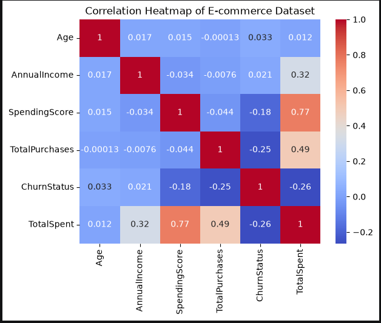
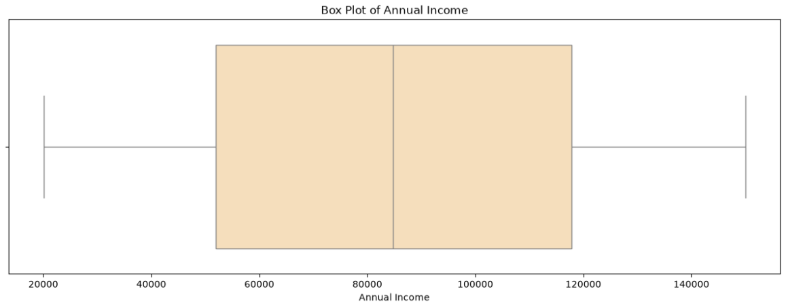
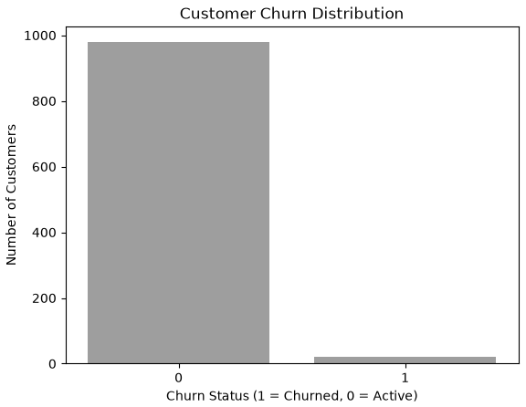
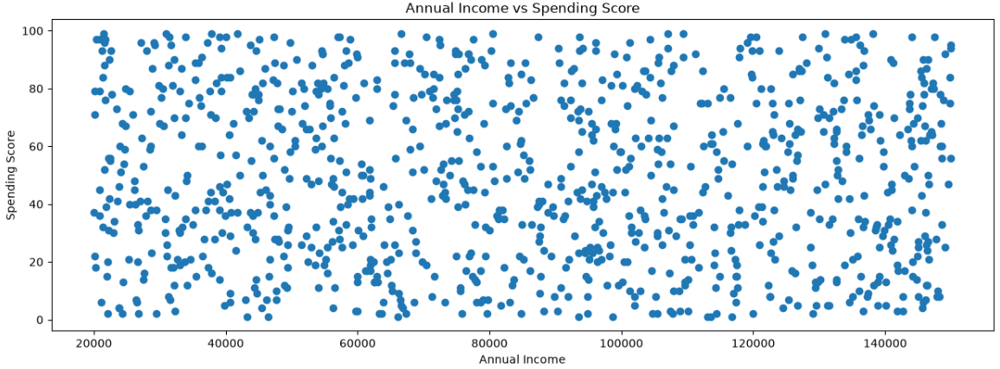
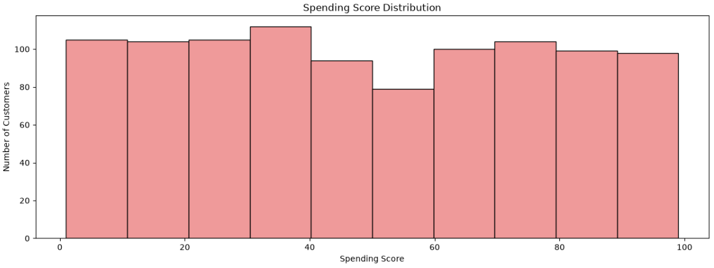

# E-Commerce Customer Analytics Using Machine Learning

## 1. Project Overview

This project applies machine learning techniques to an e-commerce customer dataset to analyze customer spending, predict customer churn, segment customers, and discover product purchasing associations.

The project demonstrates an end-to-end introductory machine learning workflow, including exploratory data analysis, model training, evaluation, customer segmentation, and association rule mining.

## 2. Business Problem

E-commerce businesses need to understand customer purchasing behavior to make better business decisions. They need to estimate customer spending, identify customers who may leave, understand different customer segments, and discover products that are frequently purchased together.

This project explores four analytical approaches to address these business questions.

## 3. Project Objectives

- Predict customer spending using regression.
- Predict customer churn using classification.
- Identify customer segments using K-Means clustering.
- Discover product associations using Apriori and association rule mining.
- Compare model performance using appropriate evaluation metrics.
- Communicate findings and limitations clearly.

## 4. Dataset Description

The project uses a programmatically generated synthetic dataset containing 1,000 records and 8 columns.

Column| Description
CustomerID| Customer identifier
Age| Customer age
AnnualIncome| Annual income
SpendingScore| Customer spending score
TotalPurchases| Total number of purchases
ChurnStatus| Customer churn indicator
TotalSpent| Total spending amount
ItemsBought| Comma-separated list of purchased products

Dataset note: The data is synthetic and intended for educational and portfolio purposes. Results should not be interpreted as evidence of real-world business performance.

## 5. Technologies Used

- Python
- Pandas
- NumPy
- Matplotlib
- Seaborn
- Scikit-learn
- MLxtend
- Jupyter Notebook

## 6. Project Workflow

**6.1 Exploratory Data Analysis**

- Inspected dataset structure, data types, missing values, and duplicate records.
- Analyzed distributions using histograms and count plots.
- Examined relationships using scatter plots and correlation analysis.
- Used box plots and the IQR method to inspect potential outliers.

**6.2 Regression: Customer Spending Prediction**

The target variable is "TotalSpent".

Models evaluated:

- Linear Regression
- Decision Tree Regressor
- Random Forest Regressor

Evaluation metrics:

- Mean Absolute Error (MAE)
- Mean Squared Error (MSE)
- Root Mean Squared Error (RMSE)
- R² Score

**6.3 Classification: Customer Churn Prediction**

The target variable is "ChurnStatus".

Models evaluated:

- Logistic Regression
- Decision Tree Classifier
- Random Forest Classifier

Evaluation metrics:

- Accuracy
- Precision
- Recall
- F1-score
- Confusion matrix

**6.4 Clustering: Customer Segmentation**

K-Means clustering was applied to scaled customer features using three clusters as an initial choice.

The resulting groups were examined using annual income, spending score, and total purchases to understand differences in customer characteristics.

**6.5 Association Rule Mining: Product Associations**

The Apriori algorithm and association rules were used to identify product combinations that occur together in customer transactions.

The analysis used:

- Support
- Confidence
- Lift

**7. Model Results**

**7.1 Regression Results**

The following results were obtained on the initial train-test split.

|Model| MAE| RMSE| R² Score|
|---|---|---|---:|
|Linear Regression| 403.10| 499.10| 0.9922|
|Decision Tree Regressor| 1,006.24| 1,295.24| 0.9476|
|Random Forest Regressor| 624.44| 802.53| 0.9799|

Linear Regression achieved the highest R² score and lowest MAE and RMSE among the three tested models on this split.

However, the high R² score requires further investigation, including examination of the synthetic data-generation process and possible target leakage, before drawing conclusions about performance on unseen data.

**7.2 Classification Results**

|Model| Accuracy| Churn Precision| Churn Recall| Churn F1-score|
|---|---|---|---|---:|
|Logistic Regression| 99%| 1.00| 0.50| 0.67|
|Decision Tree Classifier| 100%| 1.00| 1.00| 1.00|
|Random Forest Classifier| 100%| 1.00| 1.00| 1.00|

Decision Tree and Random Forest achieved identical results on the current test set. Random Forest is a candidate for further validation, but these results do not establish that it is superior.

Important limitation: The dataset contains 22 churn cases out of 1,000 records, and the test set contains only four churn cases. The reported metrics are therefore insufficient to establish reliable generalization performance.

## 8. Visualizations

### Correlation Heatmap


### Outlier analysis-Annual Income


### Customer Churn


### Annual Income Vs Spending Scores


### Spending Scores analysis


## 9. Key Findings

- "SpendingScore" showed a strong positive correlation with "TotalSpent" (approximately 0.767).
- "TotalPurchases" showed a moderate positive correlation with "TotalSpent" (approximately 0.492).
- K-Means produced three customer groups with different spending scores and purchase frequencies.
- Association rules identified product combinations with lift values greater than 1 in the analyzed dataset.

These findings describe patterns in the synthetic dataset. They do not establish causation or guarantee the same patterns in real customer data.

## 10. Project Structure
```text
ecommerce-customer-analytics/
├── ecommerce_customer_analytics.ipynb
├── ecommerce_customer_analytics_clean.csv
├── ecommerce_multitask_dataset.csv
├── README.md
├── requirements.txt
├── .gitignore
└── reports/
    ├── regression_model_comparison.csv
    ├── classification_model_comparison.csv
    └── association_rules.csv
```
## 11. How to Run the Project

**Prerequisites**

Install Python and Jupyter Notebook.

**Installation**

1. Clone or download this repository.
2. Open a terminal in the project directory.
3. Install the dependencies:
3. pip install -r requirements.txt
4. Open the notebook:
jupyter notebook ecommerce_customer_analytics.ipynb
5. Run the notebook cells in order

Dataset path: Ensure the notebook loads the CSV from the project directory. A relative path such as "pd.read_csv("ecommerce_multitask_dataset.csv")" makes the project easier to run on other computers.

## 12. Limitations

- The dataset is synthetic and may not represent real customer behavior.
- The classification dataset is imbalanced, with only 22 churn cases.
- Only four churn cases appear in the current test set.
- The regression results require further validation for possible target leakage and generalization.
- Three clusters were selected as an initial choice; the optimal number of clusters has not been established.
- Association rules indicate co-occurrence patterns, not causal relationships.

## 13. Future Improvements

- Investigate the synthetic data-generation process and potential target leakage.
- Validate classification models with repeated stratified cross-validation and suitable metrics.
- Evaluate regression performance on independent data.
- Investigate alternative customer segmentation choices.
- Develop an interactive customer analytics dashboard.
- Explore personalized product recommendations.

## 14. Conclusion

This project demonstrates an introductory end-to-end machine learning workflow for e-commerce customer analytics using regression, classification, clustering, and association rule mining.

It provides a foundation for exploring customer behavior, comparing analytical techniques, and understanding the importance of evaluating machine learning results critically.

**Author**

**Divya Patil**

**GitHub: "DivyaPatil-tech" (https://github.com/DivyaPatil-tech)**
